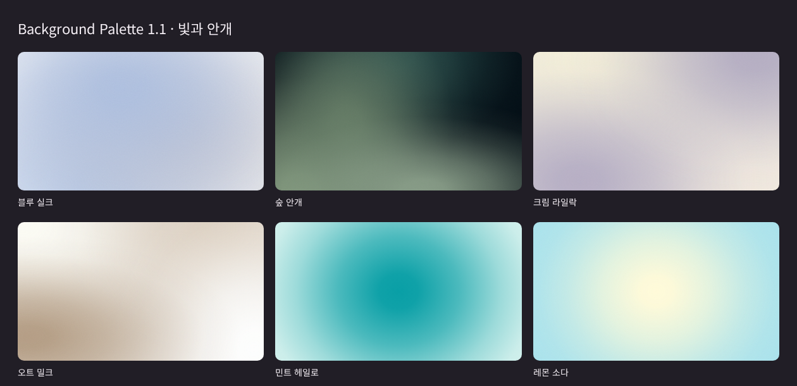

# Background Palette · 배경 팔레트

**배경 이미지를 찾을 필요 없이, 원하는 색으로 실리태번 분위기를 바꿔보세요.**

단색부터 부드럽게 번지는 메시·안개 그라데이션까지, 색상 선택기로 만들고 저장하는 SillyTavern 확장입니다.
별도 API 키나 추가 서버가 필요하지 않습니다.



## 설치

1. 실리태번 상단의 **확장 프로그램 → 확장 설치**를 엽니다.
2. 아래 주소를 붙여 넣고 설치합니다.

   ```text
   https://github.com/zzztbip/SillyTavern-Background-Palette
   ```

3. 필요한 경우 페이지를 새로고침합니다.
4. **확장 프로그램 → 배경 팔레트 → 색상 배경 사용**을 켭니다.

처음 설치할 때는 꺼져 있습니다. **모든 채팅에 공통으로 적용**되며, 설정은 자동 저장됩니다.

## 사용할 수 있는 배경

| 종류 | 표현 |
| --- | --- |
| 단색 | 선택한 색 하나로 채우기 |
| 직선 | 방향을 정해 두 색 또는 세 색을 이어 붙이기 |
| 원형 | 선택한 중심에서 바깥으로 이어지는 그라데이션 |
| 소프트 | 바탕 위에 한 가지 색이 부드럽게 번지기 |
| 메시 | 서로 다른 위치에서 네 가지 빛이 섞이기 |
| 안개 | 폭과 높이가 다른 네 가지 빛이 구름처럼 번지기 |

- **색상 선택기 / HEX 입력**: 색상 칸을 눌러 선택기를 열거나, HEX 코드를 입력합니다.
- **그라데이션 조절**: 직선의 방향, 원형·소프트의 중심, 3색의 중간 색 위치를 조절합니다.
- **빛 위치 편집**: 메시·안개에서 미리보기의 숫자 1–4를 드래그합니다. X/Y 숫자로 입력할 수도 있습니다.
- **배치 섞기**: 색상을 유지하면서 빛의 위치를 바꿉니다.
- **번짐 크기 / 부드러움 / 입자감**: 색이 퍼지는 정도와 고운 질감을 조절합니다. 입자감 0%는 매끈한 배경입니다.
- **기본 조합**: 빛과 안개 조합 6종, 기존 기본 조합 6종을 제공합니다. 누르면 바로 적용됩니다.
- **내 조합**: 이름을 붙여 최대 24개까지 저장합니다. 같은 이름은 번호를 붙여 별도로 저장합니다.
- **기존 이미지 배경으로 돌아가기**: 색상 배경을 끕니다. 선택했던 색상 조합은 유지합니다.

숫자에 키보드 초점을 두고 방향키로 빛을 움직일 수도 있습니다. Shift+방향키는 10%씩 이동합니다.

## 투명도와 기존 이미지

색상 선택기의 **A는 투명도**입니다. 1이면 불투명하고, 낮추면 아래 배경이 비칩니다.

소프트·메시·안개에서는 빛이 바탕색 위에 섞입니다. 원래 배경 이미지까지 보이게 하려면 **바탕색의 A도 낮춰주세요.**
HEX 입력은 `#181818`, `#fff`, `#AABBCC80` 형식을 지원합니다.

색상 배경이 켜진 동안 기본 배경 메뉴에서 이미지를 바꾸면, 그 이미지는 색상 레이어 아래에서 변경됩니다.
색상 배경을 끄면 현재 채팅에 선택된 이미지가 다시 보입니다.

## 예전에 ZIP으로 직접 설치했다면

예전 `Background-Palette` 폴더가 설치돼 있다면, GitHub 버전으로 옮길 때 아래 순서로 진행합니다.

1. 실리태번 서버를 종료합니다.
2. 예전에 넣었던 `Background-Palette` 폴더를 **확장 설치 폴더 밖으로 옮겨 보관**합니다.
   기본 사용자 설치 위치는 `SillyTavern/data/default-user/extensions/Background-Palette/`입니다.
   모든 사용자용으로 넣었다면 `SillyTavern/public/scripts/extensions/third-party/Background-Palette/`를 확인합니다.
3. 서버를 다시 켜고 위의 GitHub 주소로 설치합니다.

같은 실리태번 사용자 설정을 쓰면 기존 색상과 저장 조합을 그대로 불러옵니다.
사용자 설정 파일은 수정하거나 삭제할 필요가 없습니다.

## 사용 범위

- **화면 뒤의 배경**을 바꿉니다. 채팅창·입력창·UI 패널의 색상은 사용 중인 테마를 따릅니다.
- 테마가 기본 배경을 숨기거나 불투명한 요소로 덮으면 색상 배경이 보이지 않을 수 있습니다.
- 테마의 배경 필터·밝기 효과가 함께 적용될 수 있습니다.
- 단색·그라데이션은 CSS로, 입자감은 동봉된 작은 SVG 타일로 표시합니다.
- 설정에는 색상·좌표·옵션·저장 조합만 기록합니다. 이미지 데이터는 누적 저장하지 않습니다.
- RP 내용이나 프롬프트, 기존 배경 선택·잠금 정보는 수정하지 않습니다.

PC와 모바일에서의 실사용이 확인됐습니다. 모든 실리태번 버전과 테마 조합을 확인한 것은 아닙니다.

## 제작 및 라이선스

- 관리·배포: [zzztbip](https://github.com/zzztbip)
- ChatGPT의 도움으로 제작했습니다.
- 버전: 1.1.0
- MIT License — [LICENSE](LICENSE)
- [SillyTavern 확장 개발 문서](https://docs.sillytavern.app/for-contributors/writing-extensions/)
